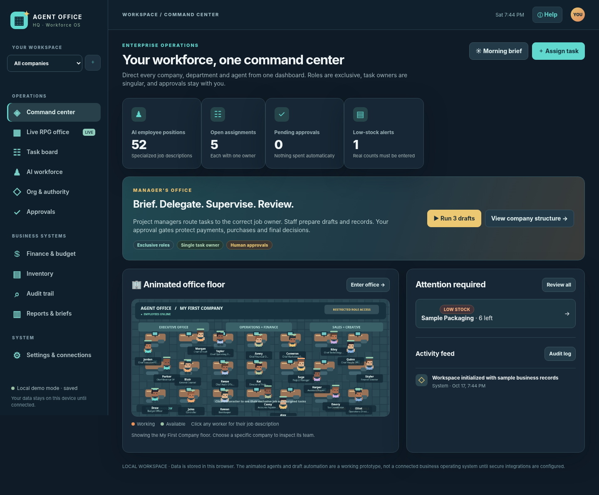

# Agent Office HQ 🏢

**GitHub-ready, mobile-friendly, RPG-style multi-business workforce dashboard.** Create separate companies, assign narrowly scoped AI-employee roles, organize projects, review approvals and track manually entered budgets/inventory while animated characters move around a virtual office.

**Screenshots:** [Dashboard](docs/images/dashboard.png) · [Animated RPG office](docs/images/rpg-office.png) · [Mobile layout](docs/images/iphone.png)



> **Prototype, not an autonomous company.** The dashboard functions as a local, interactive demo. AI drafting only works if you start the optional private Node server with an API key. There are no live sales, account, banking, inventory, social-media or payment integrations. Closing the app stops its browser-only scheduled brief checks. See [Architecture](docs/ARCHITECTURE.md) and [Security](SECURITY.md).

## Secure Cloud HQ (Supabase-backed, separate from demo)

The sidebar now includes **Secure Cloud HQ** at `cloud.html`. This page connects to the Office-HQ Supabase project `wvadoqncgrmfsftefuoy` using a **public publishable key** (safe in browser code), while the database enforces owner-only Row Level Security. It supports email/password sign-in, private companies, tasks, owner approval records, and in-app company messages. **No service-role or third-party credentials are in the public frontend.**

**Required owner setup before sign-up:** In [Supabase Auth URL Configuration](https://supabase.com/dashboard/project/wvadoqncgrmfsftefuoy/auth/url-configuration), set your Site URL and allowed Redirect URLs to the GitHub Pages Cloud HQ address:

`https://hostkris.github.io/Office-HQ/agent-office-hq/cloud.html`

After saving, open that Cloud HQ address and register/sign in with your own email. You may have to confirm your email. The original animated office and seeded sample records remain in the **local browser workspace**. Cloud HQ is a distinct real-data workspace; local example data are **not** silently uploaded or migrated.

**Not yet implemented:** autonomous agents, external OAuth account links, Gmail inbox actions, Shopify/social posting, ad purchases, real SMS, and a shared task backend for the animated dashboard. The Cloud HQ "Service signup links" page only opens legitimate provider developer portals. A stored approval is not a purchase. Session credentials are held in the current tab's session storage.

More details: [Cloud setup and limitations](docs/CLOUD_SETUP.md).

## Quick start — GitHub Pages (no API key)

1. Download the GitHub-ready ZIP and **extract it**. Create a new **GitHub repository** (for example `agent-office-hq`) and upload the **contents** of the extracted folder into the repository root, including the hidden `.github` folder. Or use `git clone`/`git push` commands shown below.
2. Ensure the default branch is named **`main`**.
3. On GitHub go to **Settings → Pages → Build and deployment → Source → GitHub Actions**. Save the setting.
4. Open the **Actions** tab. Run **Publish GitHub Pages** manually if it did not start on its own. Wait for the successful deployment.
5. Open the public URL, typically `https://YOUR-USERNAME.github.io/agent-office-hq/` (GitHub displays your actual URL in Pages settings).

This publishes the **frontend only** with fully interactive demo screens; no secret key is required or included. Since it saves to browser `localStorage`, your GitHub Pages workspace is separate from any Netlify or local copy.

### Upload with Git commands (alternative)

```bash
cd agent-office-hq-github
# If you created an empty repository on GitHub, substitute its HTTPS URL:
git init
git add .
git commit -m "Initial Agent Office HQ prototype"
git branch -M main
git remote add origin https://github.com/YOUR-USERNAME/agent-office-hq.git
git push -u origin main
```

**No GitHub account has been connected or repository created by this package.** You control the repository and its visibility. Publishing GitHub Pages from a public repository makes the static code publicly viewable; do not upload private business data.

## Run on your own computer

Requires **Node.js 22+**. No `npm install` is necessary because the project has no third-party runtime dependencies.

```bash
npm test            # Syntax, role permissions, build safety and local server smoke checks
npm run build       # Produce public frontend in dist/
npm run dev         # Run local browser app at http://127.0.0.1:3000
```

### Optional real AI-written drafts (local development only)

```bash
cp .env.example .env
# Edit .env and add your own OPENAI_API_KEY; DO NOT commit it
npm run dev:env
```

Open `http://127.0.0.1:3000`. The drafting model is configured using `OPENAI_MODEL` (default: `gpt-4.1-mini`). Normal API usage charges may apply. If no key is provided, the app uses clearly labeled **local template outputs**, not model-written drafts. The example server is local-only; it has **no login security**, so do not expose it on the public Internet.

## Deploy to Netlify from the same GitHub repository

1. Push the source repo to GitHub.
2. Choose **Add new project → Import an existing project** in Netlify, and connect the GitHub repository.
3. Netlify uses the included `netlify.toml` to run `npm run build` and publish the static `dist/` directory. No environment variables are needed for the demo.
4. Visit the published URL. Updates pushed to GitHub build and redeploy automatically.

Netlify's static build does **not** run the optional Node AI drafting server. Never set `OPENAI_API_KEY` as a public frontend variable or put it in a source file.

## Features currently in the app

| Area | Functions |
|---|---|
| Command center | Company overview, metrics, alerts and animated office preview |
| RPG office | Three floors, moving pixel avatars, click employee for position and open work |
| AI workforce | 52 unique company jobs and reporting lines, role naming, pause/resume positions |
| Projects | Exclusive assignment to a single authorized job owner, tasks and progress tracking |
| Managers | Project manager delegation, daily morning/evening brief templates and status summaries |
| Finance | Manual budget allocations, income/expense records, requests for approval |
| Inventory | Manual SKUs, counts, reorder thresholds, batch and expiry data |
| Controls | Owner approval forms, audit log, local JSON backup and restore |

New companies each get their own simulated workforce. All task permissions and financial records are demo browser-state controls; production applications must enforce access restrictions in a secure server as well.

## What gets published (and what does not)

The script `npm run build` copies only `index.html`, `app.js`, `styles.css`, `sw.js`, `icon.svg`, and `manifest.webmanifest` to `dist/`. It excludes `server.mjs`, `.env`, tests and documentation. The same build is used by GitHub Pages and Netlify. The included GitHub Actions workflows test and publish on changes to `main`.

## Data safety and limits

- The app starts with **fake sample revenue, expenses and inventory**. They are not your real business numbers.
- Data lives in the **current browser and web address only**, with no secure login or sharing across devices.
- Export **Settings → Export all data** for a JSON backup before resetting or clearing your browser data.
- The audit history is viewable/editable within browser storage and is **not a tamper-resistant audit system**.
- Daily briefs run when the app is open; no true background jobs are installed.
- No payments, supplier orders, email sending, ad purchases, transfers or other external actions occur from this version.

For the future authenticated multi-agent service architecture, see [docs/ARCHITECTURE.md](docs/ARCHITECTURE.md). If you make the GitHub repository public, the code is visible; without a separately chosen license, it isn't automatically offered for unrestricted reuse.
