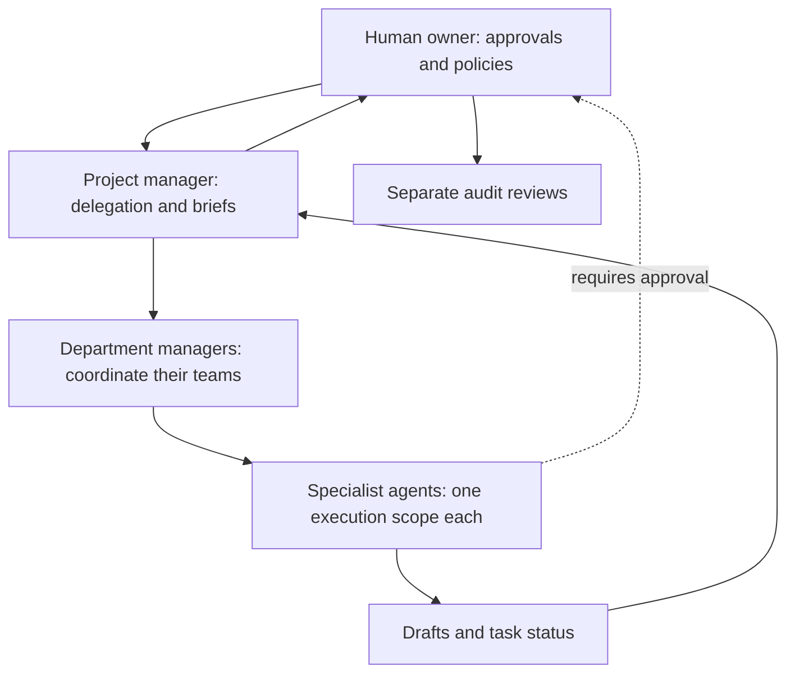

# Architecture and safe growth plan

## What ships today

This repository is a **local-first prototype**. Every company has an independent collection of role-limited simulated employees and manual business registers. The UI provides RPG-style office characters, role routing, task queues, manual finance and inventory registers, sign-off forms, a browser activity log, and on-open scheduled brief generation. This is **not** an autonomous Fortune 500 operation.

The visual employees do not represent independently running background processes. The example API service is draft-only, has no business connectors, and is not authorized for public Internet exposure.

## On-computer browser workstations (implemented, desktop-only)

The optional local Node server now has a loopback-only Playwright browser workstation service (`desktop/runner.mjs`). The owner opens a visible persistent website browser and performs sign-in and MFA manually. Scoped worker grants, paused/restartable job history and site-separated browser profiles live under `.office-hq-private/` on the computer (gitignored). One job controls each account profile at a time, and employees are limited to allowed departments/sites.

An optional AI vision model observes screenshots while a task runs; the model may be Ollama running on the same computer or OpenAI's API for decisions. Supported actions are bounded mouse/keyboard steps and CEO-gated clicks. Password, OTP, payment and account-security actions are prohibited. The bridge updates the existing animated employee thought bubbles and task status when served from the local app. Completed job summaries may be handed to a second authorized worker.

**Security limitation:** This is a single-owner local service, not secure enterprise multi-user RBAC. The frontend's employee roster is not cryptographically authenticated; strong OS account security is required. Websites may block automation; do not bypass access challenges. The browser cannot operate from GitHub Pages or from a closed computer. See `docs/DESKTOP_WORKSTATIONS.md`.

## Boundaries for a production system

For a secure production build, enforce all rules **server-side**, never just in the browser:

1. **Organizations and tenancy:** company ID on every record; authenticated owner and team memberships; company-level authorization checks on every read/write.
2. **Role model:** immutable job scopes; one designated executor per company/scope; explicit manager-to-subordinate delegation permissions. PM delegates and compiles reports, but cannot execute restricted specialist jobs.
3. **Task lifecycle:** task owner, company, scope, inputs, due date, state machine, idempotency key, evidence links, output, approval gate and full event history. Prevent double assignment with database constraints and atomic updates.
4. **Agent tool boundaries:** approved connectors per role, minimal provider permissions, secret vault, sandboxed tool execution, budget/time limits and test-mode before live actions.
5. **Human approvals:** durable server-side gates on purchases, refunds, messages, contracts, payroll and financial transfers, with an authenticated approver distinct from the requester; expiry and reversibility rules.
6. **Daily briefs:** job queue + reliable scheduler, state persisted to DB, error retries, escalation if a job fails, and delivery via an explicitly connected channel.
7. **Financial controls:** reconcile with trusted books, separate proposer/approver/executor; independent auditor only has read-only access to raw records.
8. **Security:** least privilege, MFA/SSO, audit trails stored outside normal agent write permissions, rate limiting, incident alerts and data retention policy.

## Deployment boundaries

| Environment | What it does | What it cannot do |
|---|---|---|
| GitHub Pages | Static frontend, sample/local data, all interactive visual dashboard screens | Run Node AI backend, shared multi-device DB, autonomous jobs |
| Netlify static deploy | Same frontend + source-connected continuous deploy | Run `server.mjs` automatically |
| `npm run dev` on your computer | Serve frontend and optional AI drafting through a private Node service | Run a production multi-tenant system or third-party operations |

Start with a small number of real data integrations and robust approval checkpoints before broadening the workforce.
