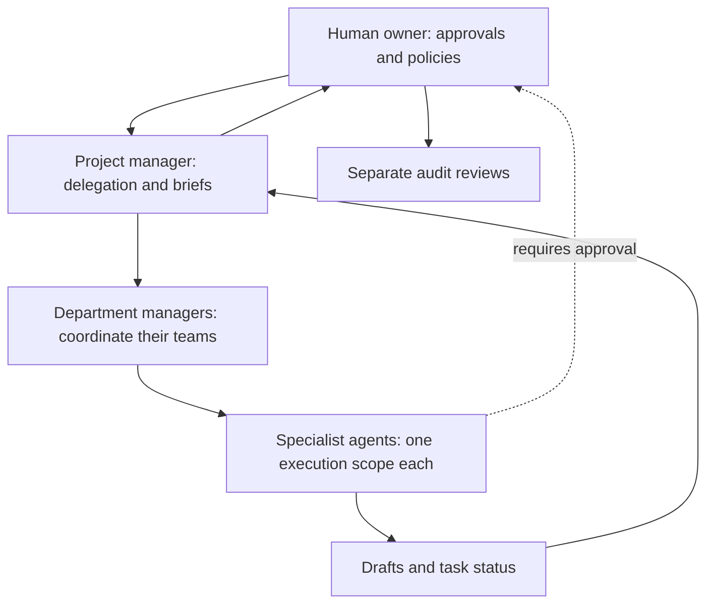

# Architecture and safe growth plan

## What ships today

This repository is a **local-first prototype**. Every company has an independent collection of role-limited simulated employees and manual business registers. The UI provides RPG-style office characters, role routing, task queues, manual finance and inventory registers, sign-off forms, a browser activity log, and on-open scheduled brief generation. This is **not** an autonomous Fortune 500 operation.

The visual employees do not represent independently running background processes. The example API service is draft-only, has no business connectors, and is not authorized for public Internet exposure.

## On-computer browser workstations (implemented, desktop-only)

The optional local Node server now has a loopback-only Playwright browser workstation service (`desktop/runner.mjs`). The owner opens a visible persistent website browser and performs sign-in and MFA manually. Scoped worker grants, paused/restartable job history and site-separated browser profiles live under `.office-hq-private/` on the computer (gitignored). One job controls each account profile at a time, and employees are limited to allowed departments/sites.

An optional AI vision model observes screenshots while a task runs; the model may be Ollama running on the same computer or OpenAI's API for decisions. Supported actions are bounded mouse/keyboard steps and CEO-gated clicks. Password, OTP, payment and account-security actions are prohibited. The bridge updates the existing animated employee thought bubbles and task status when served from the local app. Completed job summaries may be handed to a second authorized worker.

**Security limitation:** This is a single-owner local service, not secure enterprise multi-user RBAC. The frontend's employee roster is not cryptographically authenticated; strong OS account security is required. Websites may block automation; do not bypass access challenges. The browser cannot operate from GitHub Pages or from a closed computer. See `docs/DESKTOP_WORKSTATIONS.md`.

## Boundaries for a production system

For a secure production build, enforce all rules **server-side**, never just in the browser:

1. **Organizations and tenancy:** company ID on every record; authenticated owner and team memberships; company-level authorization checks on every read/write.
2. **Role model:** immutable job scopes; one designated executor per company/scope; explicit manager-to-subordinate delegation permissions. PM delegates and compiles reports, but cannot execute restricted specialist jobs.
3. **Task lifecycle:** task owner, company, scope, inputs, due date, state machine, idempotency key, evidence links, output, approval gate and full event history. Prevent double assignment with database constraints and atomic updates.
4. **Agent tool boundaries:** approved connectors per role, minimal provider permissions, secret vault, sandboxed tool execution, budget/time limits and test-mode before live actions.
5. **Human approvals:** durable server-side gates on purchases, refunds, messages, contracts, payroll and financial transfers, with an authenticated approver distinct from the requester; expiry and reversibility rules.
6. **Daily briefs:** job queue + reliable scheduler, state persisted to DB, error retries, escalation if a job fails, and delivery via an explicitly connected channel.
7. **Financial controls:** reconcile with trusted books, separate proposer/approver/executor; independent auditor only has read-only access to raw records.
8. **Security:** least privilege, MFA/SSO, audit trails stored outside normal agent write permissions, rate limiting, incident alerts and data retention policy.

## Deployment boundaries

| Environment | What it does | What it cannot do |
|---|---|---|
| GitHub Pages | Static frontend, sample/local data, all interactive visual dashboard screens | Run Node AI backend, shared multi-device DB, autonomous jobs |
| Netlify static deploy | Same frontend + source-connected continuous deploy | Run `server.mjs` automatically |
| `npm run dev` on your computer | Serve frontend and optional AI drafting through a private Node service | Run a production multi-tenant system or third-party operations |

Start with a small number of real data integrations and robust approval checkpoints before broadening the workforce.

## Authorized native team pipeline

`department-access.js` calls the loopback device-sync department-grant action.
The native bridge validates every essential role before atomically writing a batch,
excludes the human CEO, rejects duplicate specialist bindings, and records a
separate company/employee/role identity for each grant. Sync mappings retain the
company label without sharing credentials or outside account authorization.

`department-projects.js` creates independent scoped tasks, preserves the expected
team size, collects only native/cloud runtime outputs, and opens one aggregate
review. Task descriptions carry bounded team metadata so a second device can
reconstruct the same group without changing the database schema. Owner decisions
travel through the existing authenticated owner-RLS queue. No report can be
approved from partial contributions or from a mere submission receipt.

The independent native engine serializes inference jobs, checks the bound role
again before executing, retains job receipts, and preserves approved instructions
across restarts. It receives separately authorized public API evidence from
`research/public-tools.mjs`. Conversation messages use an explicit envelope through
that same bound queue and the local `office-brain.mjs` inference service.

`agent-health.js` displays real model/queue diagnostics. The Mac worker and Fix It
may resume the same transiently failed or restart-paused run after checking model,
dispatch permission, original approval, current worker binding and a two-retry cap.
A stopped or revoked run stays stopped. Local browser-origin receipts are adopted
for device-sync reporting without creating a second native job. The Mac worker
continues while its Node process is alive; a sleeping/closed Mac cannot execute.

These controls remain single-owner, local-first software. Device task/result sync
is not remote desktop access and does not synchronize every browser preference,
whole company directory, private website session or third-party credential.

## Website permission cards and Mac browser enforcement

`website-access.js` / `.css` provide the reference-style owner consent card and
company-scoped account/agent controls. `desktop/permissions.mjs` validates public
HTTPS origins, names isolated account profiles, records immutable task/worker/site
requests, and issues separate grants per specialist and origin. The 39 AI roles
retain unique catalog mandates; CEO and overlapping specialist identities are
rejected. Relevant-site grants persist until revoked. Chat grants cover the first
origin, expire within 24 hours and end on chat close or runtime restart.

The loopback-only `desktop/runner.mjs` owns visible persistent Chromium profiles.
It rechecks company, employee, role, site and active grant after model decisions
and before browser actions. Revocation cancels pending work. New origins pause
before the click and create another permission request. Ordinary external writes
require a target-bound, single-use approval ID; observe mode cannot escalate to
write approval. Authentication and money/security operations remain manual.
Browser/model factories are injectable only through module construction for
isolated tests; no HTTP endpoint can replace them.

`OFFICE_HQ_WEBSITE_ACCESS_V1:` records reuse the existing Supabase owner-RLS device
queue without new tables or service credentials. The Mac resolves phone role keys
to existing company/employee bindings, rejects unapproved specialists, and routes
control envelopes directly to the desktop service, never through the draft model.
Claimed commands return actual permission matrices and recent browser-job receipts
within the existing 16 KB result limit. A separate approval ID prevents a delayed
phone decision from approving a newer browser action. The static client marks
access pending until the Mac receipt, and cannot transfer cookies or activate a
local browser while the Mac is offline. The Mac 1.0.3 installer separately offers
Chromium and a local vision model; installing them creates no website grants.

The desktop service trusts the signed-in OS owner and same-origin localhost UI;
it is not a hostile multi-user agent sandbox. Role prompts and action gates do
not guarantee that arbitrary third-party sites support automation. Frontend grants
alone are never proof of a signed-in account or completed browser job.

## Bounded coding worker and optional cloud adapter

`native-engine/coding-worker.mjs` is a separate capability behind the existing
native company/employee/role bindings and dispatch gate. Its mode-0600 local
registry holds immutable grants for a repository root, base commit, exact read
and edit files, and approved check argv. The owner must confirm both the repository
permission and each typed `OFFICE_HQ_CODING_V1:` task. Only backend/frontend
engineering and systems integration roles can execute this capability. Existing
written-draft assignments still expose no coding tools.

The native queue serializes coding and drafting. A coding run makes a fresh local
clone with hooks/fsmonitor/global Git configuration disabled, checks out the pinned
commit and removes its remote. It excludes uncommitted source changes. File tools
reject traversal, symlinks, hidden files, known credentials and out-of-scope edits.
Edits require a plan and a current read. The loop offers file listing, literal
search with path/line evidence, reading, exact edits, explicitly approved file
creation, check execution and a gated finish operation. It does not offer a shell,
network fetch, dependency install, commit or push tool.

Approved Node/npm checks run in the separate checkout with a minimal environment,
private HOME/temp directory, no inherited provider keys or SSH agent, bounded
output and process-group cancellation. They run repository code as the OS owner;
this is not a security sandbox. Checks can have effects beyond their working
directory and must be explicitly trusted by the owner. Tracked or untracked edits
outside the approved scope fail verification; ignored build outputs are allowed.
Existing tests, scripts, package metadata and instructions cannot be edited by the
model to weaken the gate. Dependencies are not installed/copied automatically.

The loop appends actual tool results and can repair failed checks twice after its
first post-edit check. Limits are 18 model turns, 65 tool calls, three post-edit
check cycles, 20 minutes total and two minutes per check. Truncated generations
never execute their proposed calls. Finish requires a nonempty actual diff,
passing current-version checks and evidence addressing each owner criterion.
Semantic acceptance still needs CEO review. Full patches and command output stay
in the private Mac result store, with a compact report in the existing sync relay.
Interrupted coding jobs cannot use draft auto-recovery: uncertain commands are
never replayed automatically. Worker, dispatch and grant checks run before/after
model calls, before tools and around commands; revocation aborts active work.

Ollama requests use a separate selected local model, model-advertised tool and
thinking support, explicit context, `keep_alive: 10m`, bounded generation and
reported timing/token counters. Model installation is not performance evidence.
`openrouter-provider.mjs` offers only the explicitly enabled Inkling free route
and its fixed provider, with no fallback and zero price caps. Its credential lives
in a separate private Mac file. It translates native tool transcripts to provider
IDs and parses fragmented SSE, comments, tool arguments, final usage and errors.
No streamed partial action executes until a complete response has been validated.
Raw thinking is kept only in the active model transcript and never in UI/history.
The free endpoint's data policy is exposed at setup and per-task consent; private
or unverifiable GitHub commits cannot use this endpoint.

`coding-tasks.js` provides the Office HQ permission cards, task criteria, actual
run/check evidence, independent review and Mac-only patch inspection. Phone
catalog/status/stop/revoke operations use owner-authenticated
`OFFICE_HQ_CODING_CONTROL_V1:` rows. The Mac maps company names and role bindings,
rejects remote grant creation and expired/unconfirmed controls, strips local paths
from catalogs and returns bounded receipts. The phone adopts only newer catalogs;
old receipts cannot restore a revoked grant. No schema, service key or new hosted
backend was introduced. Static build output includes only the new JS/CSS controls.
